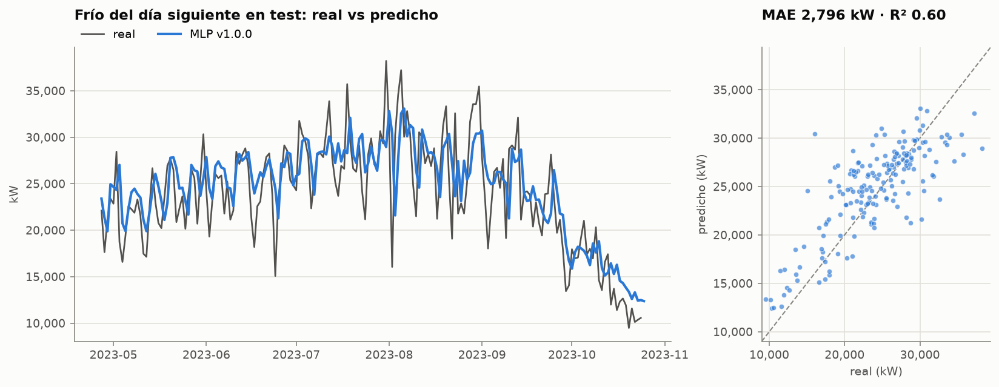
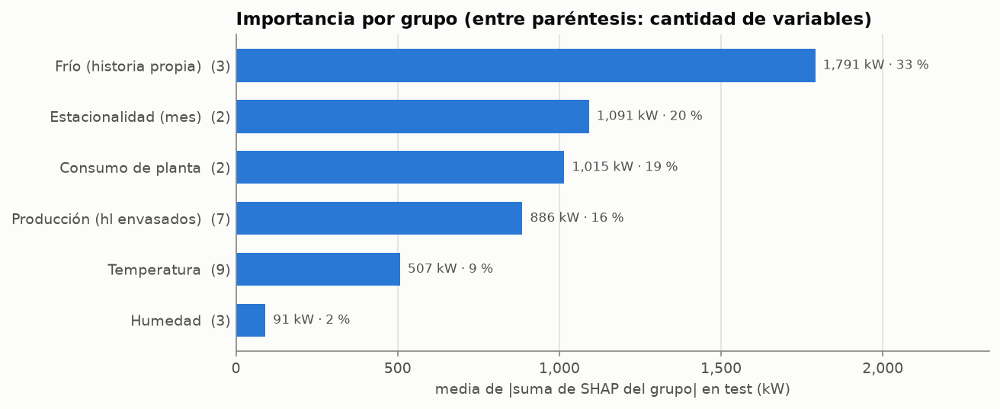
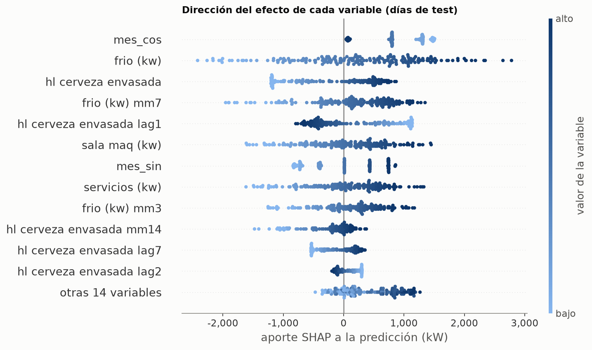
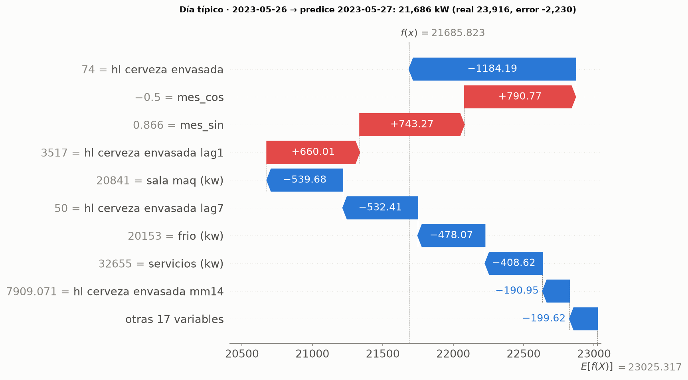
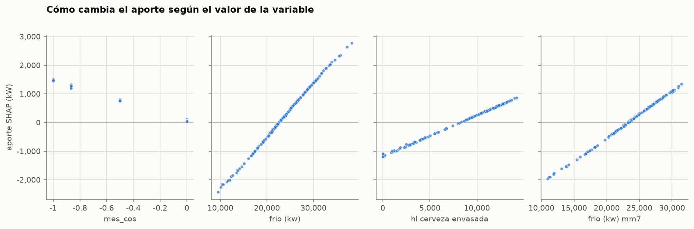
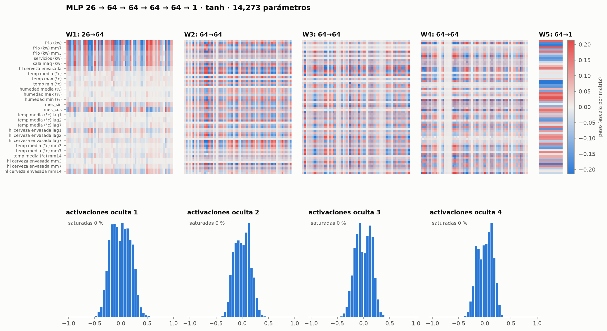
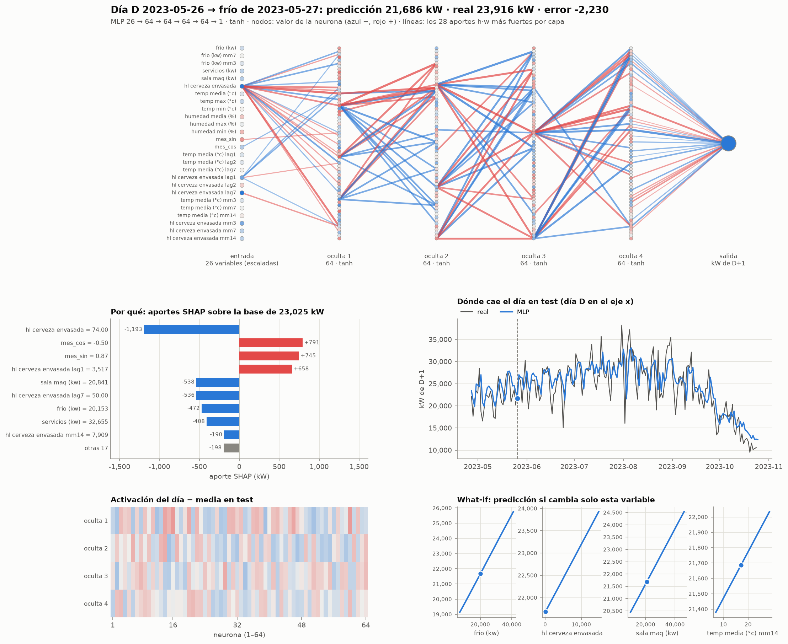

# cervecera_ml
Proyecto final para Laboratorio de Datos II.
## Grupo
- **Detzel Kolman** Axel Nicolas
- **Carrara** Ignacio
- **Jorge** Arturo

## Objetivo
Predecir el consumo energético del sistema de refrigeración, **Frío (kW) del día siguiente**, en una planta cervecera mexicana. Este README explica cómo preparar el entorno, cómo generar predicciones con `src/predict.py`.

## 1. Preparar el entorno
1. **Clonar el repositorio**
   ```bash
   git clone https://github.com/ArturoJorge/cervecera_ml.git
   cd cervecera_ml
   ```
2. **Crear el entorno e instalar las dependencias** (Python 3.12)
   ```bash
   conda create -n cervecera_env python=3.12
   conda activate cervecera_env
   pip install -r requirements.txt
   ```
   Con `venv`: `python -m venv .venv`, activarlo y ejecutar `pip install -r requirements.txt`.

Los modelos entrenados (`models/*.joblib`) y su registro (`models/model_registry.json`) ya están en el repositorio: no hace falta entrenar nada para predecir.

## 2. Predecir con `predict.py`
Desde la raíz del proyecto, con el entorno activado:
```bash
python src/predict.py "ruta/al/archivo.xlsx"
```
Esto usa la última versión del modelo `mlp` y escribe `results/predicciones.csv`.

### Opciones
| Opción | Por defecto | Qué hace |
|---|---|---|
| `--modelo` | `mlp` | Tipo de modelo del registro (`mlp` o `lasso`). |
| `--version` | `latest` | `latest` usa la versión más alta de ese tipo de modelo; también se puede pedir una específica, por ejemplo `v1.0.0`. |
| `--salida` | `results/predicciones.csv` | Ruta del `.csv` de salida. |

```bash
python src/predict.py "ruta/al/archivo.xlsx" --modelo mlp --version v1.0.0
python src/predict.py "ruta/al/archivo.xlsx" --modelo lasso --salida results/pred_lasso.csv
```

### Archivo de entrada
Un Excel `.xlsx` con el formato de los "Totalizadores Planta": registros horarios, con las columnas `dia` y `hora` en cada hoja de datos.

- Las hojas y las columnas se buscan **por nombre** (sin distinguir mayúsculas ni espacios al principio o al final). El orden no importa y las hojas o columnas de más se ignoran.
- Las columnas que el modelo `mlp` necesita sí o sí son (otros modelos pueden pedir más):

  | Hoja | Columnas |
  |---|---|
  | `Consolidado EE` | `frio (kw)`, `planta (kw)`, `sala maq (kw)`, `servicios (kw)` |
  | `Consolidado Produccion` | `hl cerveza envasada` |

  Si falta alguna, el script termina con un mensaje que dice qué columnas y qué hojas faltan.
- Solo se usan los días completos: 25 registros (24 horarios más el cierre) y un registro de cierre a las 23:30 o después.
- Conviene que el archivo tenga al menos 15 días seguidos: el modelo usa valores de hasta 14 días atrás, y las predicciones de los primeros días salen con esa historia incompleta.

### Archivo de salida
Un `.csv` con una fila por día:

| Columna | Contenido |
|---|---|
| `fecha` | Día D de los datos. |
| `prediccion_frio_kw` | Frío (kW) predicho para el día D+1. |

### A tener en cuenta
- **Conexión a internet:** el clima de la planta se baja de Open-Meteo para las fechas del Excel. Las fechas entre 2020-07-01 y 2023-10-25 ya están guardadas en `data/clima/clima_tecate.csv` y no necesitan conexión.
- **Versiones `v0.x`:** su preprocesamiento se reconstruye a partir de `data/clean/df_total.xlsx`, que no está en el repositorio. La versión por defecto (`mlp` `latest`) no lo necesita.

## 3. El modelo
El modelo de producción es **`mlp_v1.0.0`**: una red neuronal (MLP) que recibe 26 variables de un día D y predice el frío (kW) del día D+1. El análisis completo, con SHAP y un dashboard interactivo de la red, está en [`notebooks/analisis_modelo.ipynb`](notebooks/analisis_modelo.ipynb); los gráficos de esta sección salen de ahí (`reports/figuras/`).

| | |
|---|---|
| Arquitectura | 26 → 64 → 64 → 64 → 64 → 1, activación `tanh`, 14,273 parámetros |
| Entradas | frío del día y sus medias de 3 y 7 días, consumo de `servicios` y `sala maq`, hl envasados (con rezagos y medias móviles), temperatura y humedad (Open-Meteo) y el mes (`mes_sin`, `mes_cos`) |
| Preprocesamiento | variables derivadas → `Preprocess` (inválidos, outliers, faltantes) → `RobustScaler`; el target se estandariza dentro del modelo |
| Entrenamiento | train + val: 1,030 días (2020-07-01 a 2023-04-26), hiperparámetros elegidos con Optuna |
| Test (182 días nunca vistos, 2023-04-27 a 2023-10-25) | **MAE 2,796 kW**, RMSE 3,641 kW, R² 0.60; la persistencia (mañana = hoy) da MAE 3,312 kW (R² 0.43) → **≈16 % menos error** |

### Qué tan bien predice


Sigue el nivel y la estacionalidad, pero suaviza: no anticipa las caídas bruscas de un día (paradas), que no dejan ninguna señal en los datos del día anterior.

### Qué variables usa (SHAP)
SHAP reparte cada predicción en aportes en kW, uno por variable: predicción = base (23,025 kW, la predicción media) + suma de aportes.



Un tercio de lo que mueve la predicción es la **historia del propio frío**; le siguen la **época del año** (20 %), el **consumo eléctrico de planta** (19 %) y la **producción** (16 %). La temperatura pesa poco (9 %): buena parte del efecto del calor ya está en el mes y en el frío reciente.



Cada punto es un día de test; el color es el valor de la variable. Más frío hoy, más consumo de planta, más producción y meses de verano → más frío mañana. `hl cerveza envasada lag1` tiene el signo contrario al de `hl cerveza envasada`: son casi la misma variable y la red usa en parte su diferencia (cuánto cambió la producción respecto de ayer).

### Una predicción paso a paso


Un día típico de test (error igual a la mediana): ese día casi no se envasó (74 hl) y eso resta ≈1,200 kW; fines de mayo suma ≈1,500 kW. El peor día de test (2023-08-02, [waterfall](reports/figuras/shap_waterfall_peor.png)) tenía todo para un día alto (pleno verano, frío y producción altos): el modelo predijo 30,449 kW y el real fue 16,048 kW.

### Cómo funciona por dentro


Los aportes crecen en línea recta con cada variable: **en el rango de los datos la red se comporta como una regresión lineal** (≈0.19 kW más mañana por cada kW de frío hoy, ≈0.14 kW por hl envasado).



La razón está en la red: las activaciones `tanh` quedan entre −0.5 y 0.5 y ninguna se satura, y en ese rango `tanh(x) ≈ x`. La regularización L2 que eligió Optuna mantiene los pesos chicos. En la primera capa, las filas de temperatura y humedad casi no tienen peso, igual que lo que muestra SHAP.

### Dashboard


